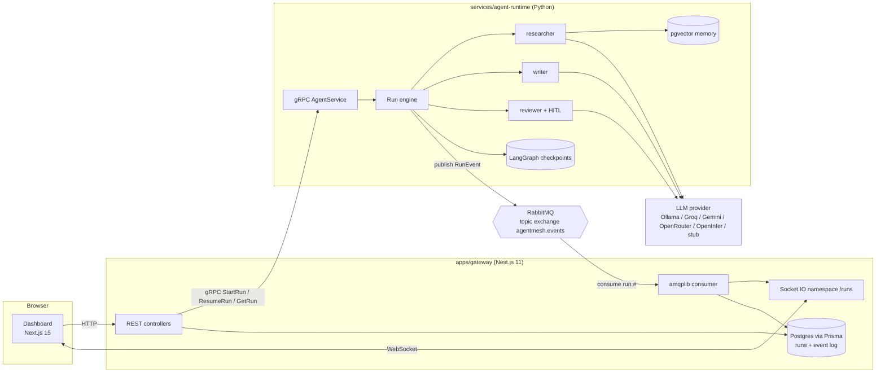
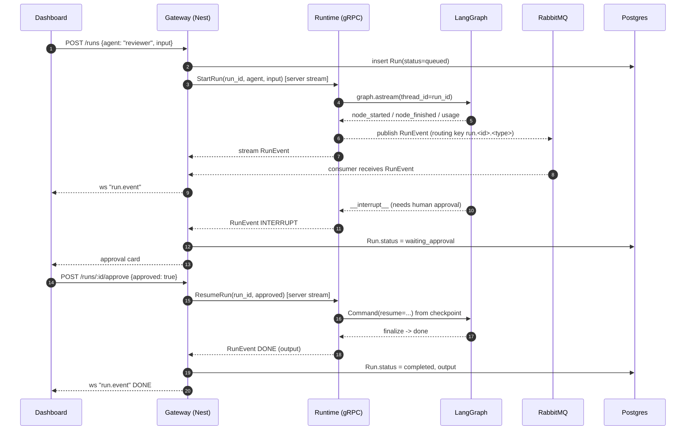

# AgentMesh

**The open, self-hostable agent operating platform.** Run LangGraph agents as independent
microservices, coordinate them over an event bus, watch them live, and keep humans in the loop.
A vendor-neutral alternative to OpenAI's Agents platform that runs on your laptop, your VPC,
or free tiers.

[](https://github.com/Hassan-Memon/agentmesh/actions/workflows/ci.yml)


> **Live demo: [agentmesh.hassan-memon.workers.dev](https://agentmesh.hassan-memon.workers.dev).**
> The dashboard runs with a simulated backend inside your browser. Start a run, watch every step
> stream in, then approve or reject the reviewer agent. To run the real services, follow the
> [Quickstart](#quickstart-no-api-keys-needed).

## Why

Hosted agent platforms are convenient until you need to run a different model, keep data in
your own network, or understand why a run did what it did. AgentMesh keeps the pieces you
actually want (durable runs, live observability, human approval, pluggable brokers and models)
and leaves out the lock-in:

- **Any model.** Ollama, Groq, Gemini, OpenRouter, or any OpenAI-compatible endpoint
  (including [OpenInfer](https://github.com/Hassan-Memon/openinfer)). A stub model makes
  `docker compose up` work with zero API keys.
- **Agents as services.** Python LangGraph graphs behind a gRPC contract. The TypeScript
  gateway never imports Python; it speaks protobuf.
- **Events, not polling.** Every node start, node finish, token usage report, interrupt and
  completion is a `RunEvent` on RabbitMQ (Kafka/Redpanda optional) and on a WebSocket.
- **Humans in the loop by design.** The `reviewer` agent pauses with LangGraph `interrupt()`;
  the dashboard shows an approval card; `POST /runs/:id/approve` resumes from the checkpoint.
- **Memory with a strategy.** Short-term state in the graph, episodic memory in Postgres
  checkpoints, semantic memory in pgvector with an HNSW index, and a context-window budgeter
  that trims by token count.

## Architecture



### A run, end to end



## Repository layout

```
apps/gateway            Nest.js 11 REST + Socket.IO gateway, gRPC client, Prisma, RabbitMQ consumer
apps/dashboard          Next.js 15 App Router dashboard (agents, runs, live timeline, HITL)
services/agent-runtime  Python gRPC server hosting LangGraph agents, memory, run engine
packages/bus            Python event-bus abstraction (in-memory, RabbitMQ, Kafka)
proto/agentmesh/v1      agent.proto: the contract between gateway and runtime
infra/                  docker-compose.yml and Postgres init
docs/                   ADRs, positioning, deploy guide, docs/learn teaching track
```

## Quickstart (no API keys needed)

```bash
git clone https://github.com/Hassan-Memon/agentmesh && cd agentmesh
cp .env.example .env
docker compose -f infra/docker-compose.yml up --build
```

Then open:

| URL | What |
| --- | --- |
| http://localhost:3000 | Dashboard |
| http://localhost:4000/health | Gateway health |
| http://localhost:4000/agents | Agent registry (JSON) |
| http://localhost:15672 | RabbitMQ management (agentmesh / agentmesh) |

Start a run from the dashboard ("New run"), pick `reviewer`, watch the timeline fill, and
approve it when the card appears. With `DEMO_MODE=1` the LLM is a deterministic stub, so the
whole thing runs offline. To use a real model set `DEMO_MODE=0` and pick a provider in `.env`
(for example `LLM_PROVIDER=groq` with `GROQ_API_KEY`, or `--profile local-llm` for Ollama).

### Run the pieces individually

```bash
# Python runtime (tests use the in-memory bus and in-memory checkpointer)
cd services/agent-runtime
uv sync
DEMO_MODE=1 uv run pytest
uv run python -m agentmesh_runtime            # gRPC on :50051

# Gateway
cd apps/gateway
npm ci && npx prisma generate
npm run build && npm test
npm run start:dev                               # REST + WS on :4000

# Dashboard
cd apps/dashboard
npm ci && npm run dev                           # :3000
```

## API surface

| Method | Path | Purpose |
| --- | --- | --- |
| GET | `/agents` | List registered agents (via gRPC `ListAgents`) |
| POST | `/runs` | Start a run `{agent, input, metadata?}`; returns the run record |
| GET | `/runs` | List recent runs |
| GET | `/runs/:id` | Run record with status, output and interrupt payload |
| GET | `/runs/:id/events` | Persisted event log for the run |
| POST | `/runs/:id/approve` | Resume a run waiting on a human `{approved, feedback?}` |
| WS | `/runs` namespace | `join` a run id, receive `run.event` messages |

The gRPC contract lives in [`proto/agentmesh/v1/agent.proto`](proto/agentmesh/v1/agent.proto).

## Free deploy path

Everything below is a free tier. Full steps in [`docs/deploy.md`](docs/deploy.md).

| Component | Where | Notes |
| --- | --- | --- |
| Dashboard | Vercel (Hobby) | `apps/dashboard` as root, set `NEXT_PUBLIC_GATEWAY_URL` |
| Dashboard demo (no backend) | Cloudflare Workers (free) | `npm run cf:deploy` in `apps/dashboard`; simulated backend in the browser, live at https://agentmesh.hassan-memon.workers.dev |
| Gateway | Render free web service | Dockerfile `apps/gateway/Dockerfile`, context repo root |
| Agent runtime | Render free web service | Dockerfile `services/agent-runtime/Dockerfile`; gRPC over HTTP/2 |
| Postgres + pgvector | Neon free | `DATABASE_URL` for both gateway and runtime |
| RabbitMQ | CloudAMQP "Little Lemur" | `BUS_URL` and `RABBITMQ_URL` |
| MongoDB (optional) | Atlas M0 | `MONGO_URL` enables the Mongo event log |
| LLM | Groq / Gemini / OpenRouter free API, or Ollama locally | `LLM_PROVIDER` |

## Learn from it

`docs/learn/` is a short teaching track written for a Python developer meeting Node, Nest,
Next, gRPC and message brokers for the first time:

1. [Architecture walkthrough](docs/learn/01-architecture-walkthrough.md)
2. [System design trade-offs](docs/learn/02-system-design-tradeoffs.md)
3. [Concepts](docs/learn/03-concepts/) (gRPC, brokers, Nest DI, App Router, WebSockets vs SSE vs WebRTC, Prisma, Docker multi-stage, LangGraph interrupts, pgvector HNSW, context budgeting)
4. [Interview talk track](docs/learn/04-interview-talk-track.md)
5. [Run it yourself](docs/learn/05-run-it-yourself.md)

Architecture decisions are in [`docs/adr/`](docs/adr/). Who this is for and why it wins is in
[`docs/positioning.md`](docs/positioning.md).

## Status

MVP, version 0.1.0. See [CHANGELOG.md](CHANGELOG.md) for the full history.

Verified: 24 agent-runtime tests, 9 event-bus tests and 11 gateway tests pass offline. The gateway
and dashboard build and lint cleanly, and all three Docker images build. The gateway talks to the
Python runtime over real gRPC, and a human approval pause and resume works end to end over gRPC.
The public demo was checked in a browser at desktop and phone widths.

Not yet verified: the full `docker compose up` stack against a real Postgres and RabbitMQ, the
Kafka adapter against a broker, and calls to a real LLM provider. Authentication and multi-tenancy
are not built yet.

## License

Apache-2.0. Copyright 2026 Hassan Memon.

## Curriculum

A cross-product course on architecture, system design, market worth, marketing, selling and job hunting lives in [docs/curriculum](docs/curriculum/00-README.md).
