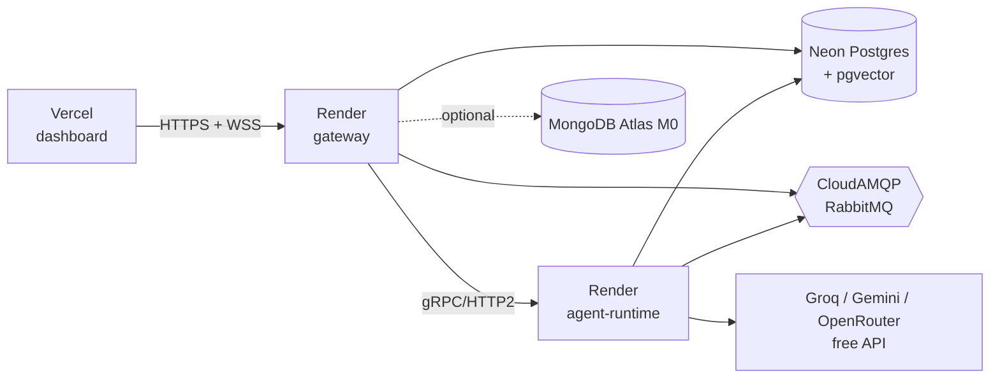

# Free deploy guide

Everything below uses free tiers only. Total monthly cost: zero. The trade-off is cold starts
(Render free services sleep after 15 minutes idle) and modest limits, which is fine for a
demo or a small team.



## 0. Prerequisites

- Fork or push this repo to GitHub.
- Decide on an LLM: `DEMO_MODE=1` (stub, no key) works everywhere. For real answers, create a
  free API key at Groq, Google AI Studio (Gemini) or OpenRouter.

## 1. Postgres with pgvector: Neon

1. Create a project at neon.tech (free tier). Copy the pooled connection string.
2. Run once from your machine to enable the extension (Neon ships pgvector):
   `psql "$DATABASE_URL" -c "CREATE EXTENSION IF NOT EXISTS vector;"`
   (The runtime also runs this on startup, so this step is optional.)
3. Apply the gateway schema:
   `cd apps/gateway && DATABASE_URL=... npx prisma migrate deploy`

Both the gateway and the runtime use the same `DATABASE_URL`. The runtime creates its own
tables (`checkpoints*`, `agent_memories`) on first start.

## 2. RabbitMQ: CloudAMQP "Little Lemur"

1. Create an instance on the Little Lemur (free) plan.
2. Copy the AMQPS URL. Set it as `BUS_URL` (runtime) and `RABBITMQ_URL` (gateway).

Limits: 1M messages/month and 20 connections. Each gateway replica and the runtime use one
connection each.

## 3. Agent runtime: Render web service

1. New Web Service, connect the repo, Environment: Docker.
2. Dockerfile path `services/agent-runtime/Dockerfile`, Docker build context `.` (repo root).
3. Port: `50051`. Render speaks HTTP/2 to Docker services, which gRPC needs.
4. Environment variables:

| Name | Value |
| --- | --- |
| `DEMO_MODE` | `1` for the stub, `0` for a real model |
| `LLM_PROVIDER` | `groq` (or `gemini`, `openrouter`, `openinfer`) |
| `LLM_MODEL` | for Groq, for example `llama-3.1-8b-instant` |
| `GROQ_API_KEY` | your key (only when `DEMO_MODE=0`) |
| `DATABASE_URL` | Neon connection string |
| `BUS_URL` | CloudAMQP URL |
| `AGENT_RUNTIME_GRPC_PORT` | `50051` |

Free tier note: the service sleeps when idle. The first run after a sleep takes 30 to 60
seconds while the container starts; the gateway's gRPC client reconnects automatically.

## 4. Gateway: Render web service

1. New Web Service, Docker, Dockerfile path `apps/gateway/Dockerfile`, context `.`.
2. Port `4000`.
3. Environment variables:

| Name | Value |
| --- | --- |
| `PORT` | `4000` |
| `DATABASE_URL` | Neon connection string |
| `RABBITMQ_URL` | CloudAMQP URL |
| `AGENT_RUNTIME_GRPC_URL` | the runtime's internal host, for example `agentmesh-runtime:50051` when both services are in the same Render project (use the private network host), otherwise the public hostname on port 443 with TLS (see note) |
| `CORS_ORIGIN` | your Vercel URL, for example `https://agentmesh.vercel.app` |
| `MONGO_URL` | optional, Atlas M0 connection string |

The container runs `prisma migrate deploy` at startup, so the schema stays current.

Note on gRPC over the public internet: the client uses insecure credentials by default,
which is right for a private network. If the runtime is only reachable via a public TLS
endpoint, switch `grpc.credentials.createInsecure()` to `createSsl()` in
`apps/gateway/src/grpc/agent-grpc.client.ts` or keep both services in one Render private
network. Keeping them together is simpler and is the recommended layout.

## 5. Dashboard: Vercel

1. Import the repo in Vercel. Root directory: `apps/dashboard`. Framework: Next.js.
2. Environment variable `NEXT_PUBLIC_GATEWAY_URL=https://<your-gateway>.onrender.com`.
3. Deploy. Add the Vercel URL to the gateway's `CORS_ORIGIN`.

The dashboard talks to the gateway directly from the browser (REST and Socket.IO), so the
gateway must allow the Vercel origin.

### 5b. Dashboard demo: Deploy to Cloudflare Workers (free)

A standalone public demo of the dashboard with no backend at all. Live at
https://agentmesh.hassan-memon.workers.dev.

With `NEXT_PUBLIC_DEMO_MODE=1` the dashboard swaps the gateway for an in-browser simulation
(`apps/dashboard/src/lib/demo/`) that speaks the same REST and Socket.IO contract: the three
agents, a few seeded runs, live RunEvents on timers, the reviewer's interrupt and the approval
card. Runs are kept in the visitor's `sessionStorage`. Every page shows a banner saying the
backend is simulated, so nobody mistakes it for a real deployment.

```bash
cd apps/dashboard
npx wrangler login            # once
npm run cf:build              # next build + OpenNext bundle, with NEXT_PUBLIC_DEMO_MODE=1
npm run cf:preview            # optional: build and serve locally with wrangler dev
npm run cf:deploy             # build and deploy the "agentmesh" worker to workers.dev
```

- Config lives in `apps/dashboard/wrangler.jsonc` (worker name `agentmesh`, `nodejs_compat`,
  static assets binding, `workers_dev: true`) and `apps/dashboard/open-next.config.ts`.
- No R2, KV or D1 bindings are used, so the Workers free plan is enough. The compressed worker
  is about 0.9 MiB, well under the free plan's 3 MiB limit. Check it any time with
  `npx wrangler deploy --dry-run --outdir .wrangler/dry-run` after `cf:build`.
- The demo flag is a build-time value: the Docker image and `npm run build` never set it, so
  they keep talking to the real gateway.

## 6. Optional: MongoDB Atlas M0 for the event log

Create a free M0 cluster, allow access from anywhere (Render IPs are not fixed on the free
tier), and set `MONGO_URL` on the gateway. Events then go to the `run_events` collection
instead of the Postgres `RunEvent` table. Nothing else changes.

## 7. Optional: local model with Ollama

On your own machine: `docker compose -f infra/docker-compose.yml --profile local-llm up`,
then `docker compose exec ollama ollama pull llama3.2`, set `DEMO_MODE=0` and
`LLM_PROVIDER=ollama`. Oracle Cloud Always Free (4 OCPU ARM, 24 GB) is a good host for Ollama
with 3B to 8B models if you want a remote local model for free.

## 8. Alternatives at zero cost

- Hugging Face Spaces (Docker, CPU): good for the runtime with `DEMO_MODE=1`; gRPC is not
  exposed through Spaces, so you would need an HTTP shim. Not recommended for this project.
- Oracle Always Free ARM VM: run the entire `docker compose` stack on one VM. Best option if
  you want no cold starts. Put Caddy in front for TLS.
- AWS free tier (documented, not required): ECS on Fargate is not free; a single `t4g.small`
  for 750 hours/month during the first year can run the compose stack like the Oracle VM.

## 9. Verifying a deploy

1. `GET https://<gateway>/health` should return `runtimeReachable: true` and `busRelay: true`.
2. `GET https://<gateway>/agents` lists `researcher`, `writer`, `reviewer`.
3. Open the dashboard, start a `reviewer` run, approve it, and confirm the status flips to
   Completed. Check the CloudAMQP console: the `agentmesh.events` exchange shows traffic.
